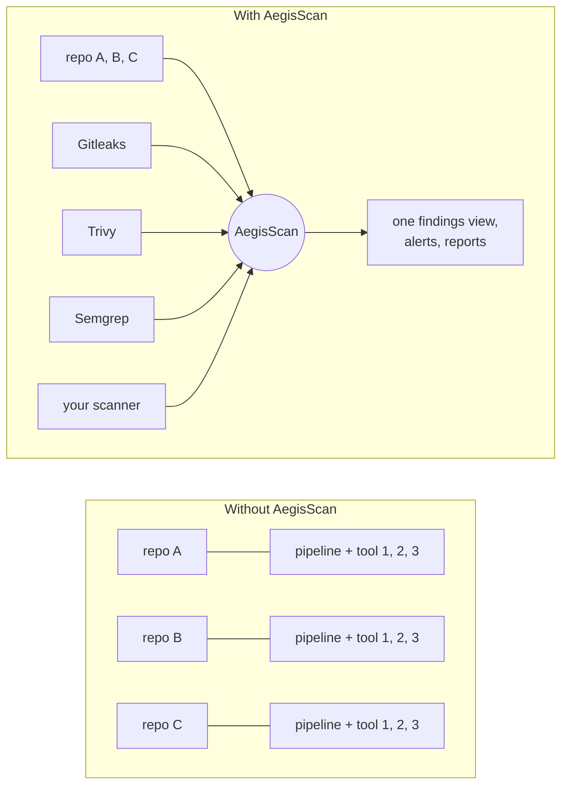
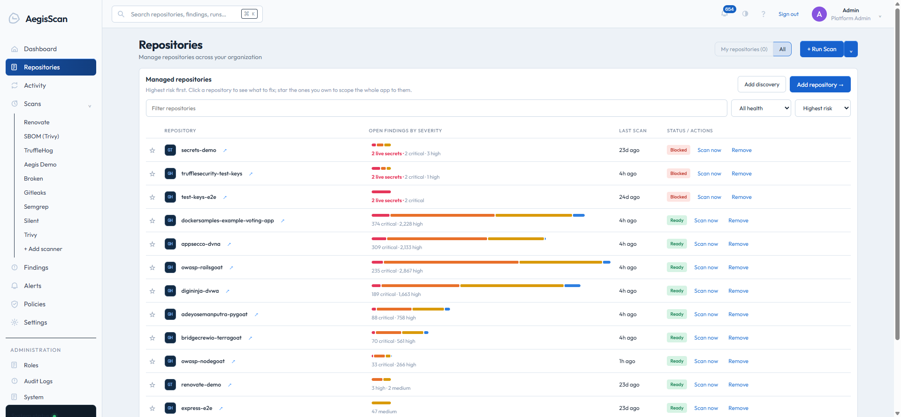
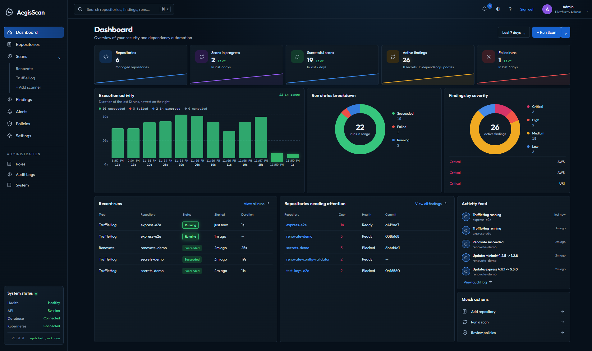
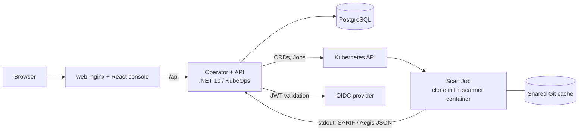
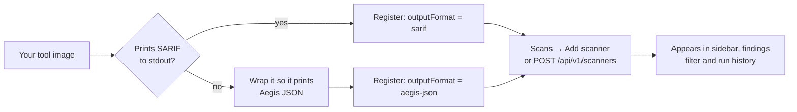

<p align="center">
  
</p>

<h1 align="center">AegisScan</h1>

<p align="center">
  <b>A harness for security scanners.</b> Plug in any scanner as a container, point it at your repos,<br>
  and get one consolidated view of the findings. No per-repo pipelines.
</p>

<p align="center">
  <a href="https://github.com/Jasonrve/AegisScan/actions/workflows/ci.yml"></a>
  <a href="https://github.com/Jasonrve/AegisScan/actions/workflows/docs.yml"></a>
  <a href="LICENSE"></a>
  <a href="https://github.com/Jasonrve/AegisScan/releases"></a>
  <a href="https://github.com/Jasonrve/AegisScan/pkgs/container/aegisscan"></a>
  
  
  
</p>

<p align="center">
  <a href="https://jasonrve.github.io/AegisScan/">Documentation</a> ·
  <a href="https://jasonrve.github.io/AegisScan/guide/getting-started">Getting started</a> ·
  <a href="https://jasonrve.github.io/AegisScan/guide/adding-a-scanner">Add a scanner</a> ·
  <a href="https://jasonrve.github.io/AegisScan/roadmap">Roadmap</a>
</p>

> **Status: MVP.** It runs end to end, but it is early software. Read [what is missing](#whats-missing) before adopting it.

## What is AegisScan?

AegisScan **runs other people's scanners for you** (Gitleaks, Trivy, Semgrep, TruffleHog, or your own) across all your repositories, and **puts every result in one place**.

Today, scanning N repos with M tools means N × M pipelines to write, secure and maintain, plus M different report formats. With AegisScan you do it once:



1. **Add repositories** (one by one, or let discovery find them).
2. **Plug in scanners.** A scanner is just a container image that prints SARIF or simple JSON. AegisScan clones each repo once, runs every scanner against it in Kubernetes, and cleans up.
3. **Read one report.** Findings from all tools are normalised (severity, file, line), deduplicated across rescans, triaged in one place, and sent out as alerts or webhooks.

You never write a pipeline per repo, and adding a new scanner means adding one container, not touching any repository.

<p align="center">
  <br>
  <sub>Repositories: every repo, ranked by risk, with findings from all plugged-in scanners (listed in the sidebar).</sub>
</p>

<p align="center">
  <br>
  <sub>Dashboard: runs, findings by severity and activity across all repositories.</sub>
</p>

## Features

- **Repository discovery and scheduling** through `Repository`, `RepositorySource` and `ScanPolicy` CRDs reconciled by a KubeOps operator.
- **One clone, many tools.** A shared Git cache means every scanner reads the same checkout and never clones anything itself.
- **Built-in scanners:** TruffleHog (secrets), Renovate (dependency updates and PRs), SBOM generation.
- **Bring your own scanner:** any container that prints SARIF or Aegis JSON, no code needed ([guide](https://jasonrve.github.io/AegisScan/guide/adding-a-scanner)).
- **Findings workflow:** severity, triage, auto-resolve, repository blocking on verified secrets, alerts and webhooks.
- **Operations-ready:** OIDC auth with Admin / Operator / Viewer roles, audit log, Prometheus metrics, hardened non-root pods, signed multi-arch images.

## Quick start

### Local, with Docker Compose (about 5 minutes)

```bash
git clone https://github.com/Jasonrve/AegisScan.git && cd AegisScan
docker compose up --build -d
```

Open <http://localhost:3000> and sign in as `admin` / `admin123` (demo realm, local use only).
This starts PostgreSQL, Keycloak, a throw-away k3s cluster for scan Jobs, the operator/API and the web console.

### On Kubernetes, with Helm

```bash
kubectl apply -f deploy/crds                       # CRDs (Helm does not upgrade them)
kubectl create namespace aegisscan
kubectl -n aegisscan create secret generic aegisscan-database \
  --from-literal=connection-string="Host=postgresql;Port=5432;Database=aegisscan;Username=aegisscan;Password=CHANGE_ME"

helm upgrade --install aegisscan oci://ghcr.io/jasonrve/charts/aegisscan -n aegisscan \
  --set authentication.authority=https://keycloak.example.com/realms/aegisscan
```

Sign-in is configurable with `--set web.loginMode=sso|password|both`.

You need Kubernetes 1.24+. PostgreSQL and Keycloak can be bundled with `--set postgresql.enabled=true --set keycloak.enabled=true --set keycloak.publicUrl=...`, or bring your own. Details: [installation](https://jasonrve.github.io/AegisScan/operations/installation).

## Architecture



## Extending: add a scanner container



What a scanner container needs:

1. A **public image** that scans `{{workspace}}` (`/workspace/repo`, already checked out) non-interactively.
2. Runs as **non-root**, writes only to `/tmp`.
3. Prints **SARIF 2.1.0** or **Aegis JSON** to stdout, and exits with a code you list in `successExitCodes`.

Example, registering Gitleaks:

```bash
curl -X POST "$AEGIS/api/v1/scanners" -H "Authorization: Bearer $TOKEN" -H 'Content-Type: application/json' -d '{
  "id": "gitleaks", "name": "Gitleaks", "image": "zricethezav/gitleaks:v8.21.2",
  "command": ["gitleaks"],
  "args": ["dir","{{workspace}}","--report-format","sarif","--report-path","/dev/stdout","--no-banner","--exit-code","1"],
  "outputFormat": "sarif", "category": "secrets", "successExitCodes": [0,1]
}'
```

Full walkthrough with diagrams: [Adding a scanner](https://jasonrve.github.io/AegisScan/guide/adding-a-scanner). Ready-made Gitleaks, Trivy and Semgrep definitions: [Custom scanners](https://jasonrve.github.io/AegisScan/operations/custom-scanners).

| Extension point | How |
|---|---|
| New scanner | Container + SARIF / Aegis JSON (no code) |
| Repository sources | `RepositorySource` CRD |
| Scan scope and schedule | `ScanPolicy` CRD |
| Notifications | Webhooks |
| Bespoke output format | Parser in `src/AegisScan.Operator/Scanning/` |

## What's missing

- Web login targets **Keycloak-style OIDC** endpoints; generic OIDC discovery, SAML and SCIM are not implemented.
- The optional bundled Keycloak is single-replica with an embedded database (use an external IdP or your own Keycloak for HA).
- **Single namespace, single tenant** ([ADR 0002](docs/adr/0002-tenancy-scope.md)).
- Pull-request automation and permalinks are tested against **GitHub and Gitea** only.
- Helm does not upgrade CRDs; the chart is published to GHCR (OCI) only, no ArtifactHub listing yet.
- Integration tests run on a single k3s version.

Full list: [Status and roadmap](https://jasonrve.github.io/AegisScan/roadmap).

## Repository layout

| Path | Contents |
|---|---|
| `src/AegisScan.Operator` | Operator + REST API (.NET 10, KubeOps) |
| `web` | React console (Vite) and Playwright e2e tests |
| `deploy/helm/aegisscan` | Helm chart (CRDs included) |
| `deploy/crds` | Standalone CRDs |
| `docs` | VitePress documentation (published to GitHub Pages) |
| `tests` | Operator tests |

## Development

```bash
dotnet test AegisScan.sln
cd web && npm ci && npm test && npm run build
cd docs && npm ci && npm run dev
```

See [CONTRIBUTING](CONTRIBUTING.md). Report vulnerabilities per [SECURITY](SECURITY.md).

## License

[MIT](LICENSE)
