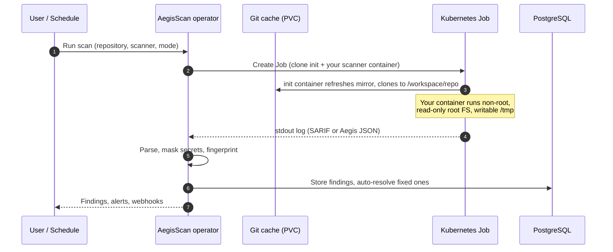
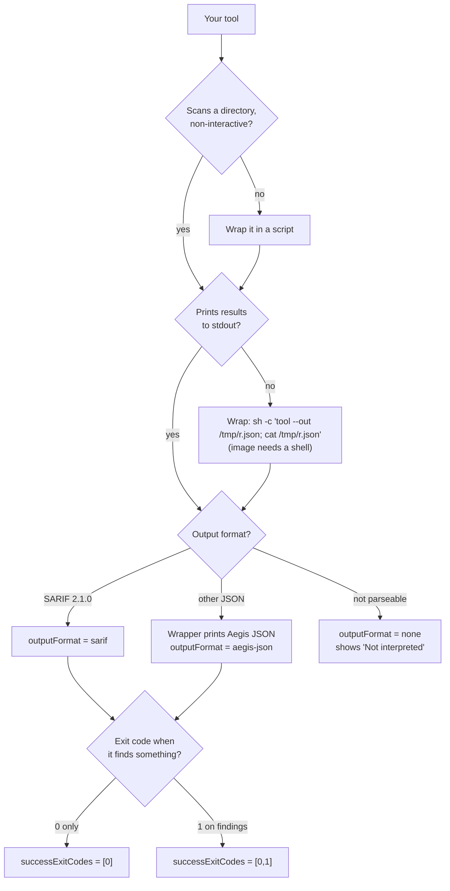
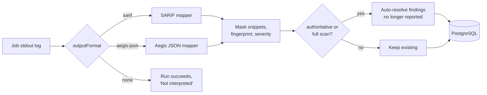

# Adding a scanner container

Any container image that can scan a directory and print results to **stdout** can be an AegisScan scanner. No operator code changes are needed for tools that emit [SARIF 2.1.0](https://docs.oasis-open.org/sarif/sarif/v2.1.0/sarif-v2.1.0.html) or the simple *Aegis JSON* format.

## What AegisScan does for you



Your container **never clones anything**. The repository is already checked out in `{{workspace}}` (`/workspace/repo`, also the working directory).

## What your container must satisfy



Checklist:

- **Image** pullable by the cluster (public image).
- Runs as a **non-root** user and does not write outside `/tmp` (`HOME=/tmp`).
- Reads from `{{workspace}}`; do not assume network access.
- Prints one JSON document to stdout. Log noise around it is tolerated, or wrap it in `AEGIS-RESULT-BEGIN` / `AEGIS-RESULT-END` lines.
- Exits with a code listed in `successExitCodes`; anything else is a failed, retried run.

## Add it

### In the UI

**Scans → + Add scanner**: fill in image, command, args, output format, category and exit codes. Use the built-in **preview** to paste sample output and see the findings AegisScan would create before saving.

### Through the API

```bash
curl -X POST https://aegisscan.example.com/api/v1/scanners \
  -H "Authorization: Bearer $TOKEN" -H 'Content-Type: application/json' \
  -d '{
    "id": "gitleaks",
    "name": "Gitleaks",
    "image": "zricethezav/gitleaks:v8.21.2",
    "command": ["gitleaks"],
    "args": ["dir","{{workspace}}","--report-format","sarif","--report-path","/dev/stdout","--no-banner","--exit-code","1"],
    "outputFormat": "sarif",
    "category": "secrets",
    "successExitCodes": [0,1]
  }'
```

Placeholders available in `args`: `{{workspace}}`, `{{repository}}`, `{{branch}}`, `{{mode}}` (`incremental` or `full`). The scanner then appears in the sidebar, the findings filter and run history automatically.

## Building your own scanner image

```dockerfile
FROM alpine:3.20
RUN apk add --no-cache jq grep
COPY scan.sh /scan.sh
USER 65532
ENTRYPOINT ["/scan.sh"]
```

```sh
#!/bin/sh
# scan.sh: print Aegis JSON for every TODO(security) marker
cd "${1:-/workspace/repo}"
grep -rn "TODO(security)" . | jq -R -s '
  {aegisVersion:1, authoritative:true,
   findings: [split("\n")[] | select(length>0) | split(":") |
     {id:"todo-security", title:"Security TODO", severity:"low",
      path:.[0], line:(.[1]|tonumber), detail:(.[2:]|join(":"))}]}'
```

Register it with `args: ["{{workspace}}"]`, `outputFormat: "aegis-json"`, `category: "code"`.

## How output becomes findings



Full field reference, severity mapping and ready-made definitions for Gitleaks, Trivy and Semgrep: [Custom scanners](/operations/custom-scanners).

## When you do need code

Only a tool whose output is neither SARIF nor Aegis JSON *and* cannot be wrapped needs a parser in `src/AegisScan.Operator/Scanning/` (see `TruffleHogResultParser.cs` for the pattern) plus a catalog entry. Prefer the wrapper approach.
