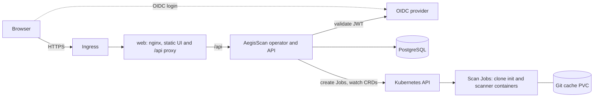

# Installation

The quick path is in [Getting started](/guide/getting-started). This page covers the details.

## Components



## Steps

1. **CRDs**: `kubectl apply -f deploy/crds` (Helm never upgrades CRDs; see [CRD upgrades](/operations/crd-upgrades)).
2. **Database**: either `--set postgresql.enabled=true` (bundled PostgreSQL, see below) or a Secret named by `database.existingSecret` (default `aegisscan-database`, key `connection-string`) holding an Npgsql connection string. Bring your own PostgreSQL otherwise.
3. **OIDC**: create a public client (default id `aegisscan-web`, PKCE code flow) whose tokens carry the `aud` claim you set in `authentication.audience` and a `groups` claim containing `admin` or `operator` (anything else is a viewer). See [Identity](/operations/identity).
4. **Install**:

```bash
helm upgrade --install aegisscan oci://ghcr.io/jasonrve/charts/aegisscan -n aegisscan --create-namespace \
  --set authentication.authority=https://idp.example.com/realms/aegisscan
```

`authentication.authority` is required unless you enable the bundled Keycloak; the chart refuses to render without it. From a checkout, use `deploy/helm/aegisscan` instead of the OCI reference.

## Bundled dependencies (subcharts)

Both are optional and off by default; the chart runs against external services too.

| Component | Enable | Subchart | Notes |
|---|---|---|---|
| PostgreSQL | `--set postgresql.enabled=true` | `groundhog2k/postgres` (official `postgres` image) | The chart creates the `aegisscan-database` Secret with a generated password (kept across upgrades) and wires the connection string. Tune with `postgresql.storage.*`. |
| Keycloak | `--set keycloak.enabled=true --set keycloak.publicUrl=https://auth.example.com` | `codecentric/keycloakx` (official Keycloak image) | Imports an `aegisscan` realm (client, `groups` claim, audience mapper). The admin password is in Secret `aegisscan-keycloak-admin`. Create users in the Keycloak console and add them to the `admin` / `operator` / `viewer` groups. Embedded database on a 1 Gi PVC, single replica: fine for evaluation and small teams; use an external IdP or a database-backed Keycloak for HA. Expose it through your own ingress at `keycloak.publicUrl` (Service `<release>-keycloak-http`). |

All-in-one example:

```bash
helm dependency build deploy/helm/aegisscan   # only needed from a checkout
helm upgrade --install aegisscan deploy/helm/aegisscan -n aegisscan --create-namespace   --set postgresql.enabled=true   --set keycloak.enabled=true --set keycloak.publicUrl=https://auth.example.com   --set ingress.enabled=true --set 'ingress.hosts[0].host=aegisscan.example.com'   --set 'ingress.hosts[0].paths[0].path=/' --set 'ingress.hosts[0].paths[0].pathType=Prefix'
```

## Sign-in options

`web.loginMode` controls the login screen: `both` (default), `sso` (redirect only) or `password` (username and password only). Password sign-in uses the OAuth2 password grant against the identity provider, so the OIDC client must allow direct access grants (the bundled realm does unless `loginMode=sso`). The web console currently expects Keycloak-style endpoints (see [roadmap](/roadmap)).

## Images

| Image | Built from | Notes |
|---|---|---|
| `ghcr.io/jasonrve/aegisscan` | `Dockerfile` | Operator and API, non-root (65532), port 8080 |
| `ghcr.io/jasonrve/aegisscan-web` | `web/Dockerfile` | nginx-unprivileged, port 8080; reads `OIDC_AUTHORITY`, `OIDC_ISSUER`, `OIDC_CLIENT_ID`, `AEGIS_API_UPSTREAM` at container start |

Build locally: `docker build -t aegisscan .` and `docker build -t aegisscan-web web`.

The chart also creates RBAC, probes (`/healthz`, `/readyz`), a PodDisruptionBudget and a restrictive NetworkPolicy. Egress from the API pod is limited to DNS, PostgreSQL, and TCP 443/22; if your OIDC provider or Git host uses other ports, adjust the NetworkPolicy template.
